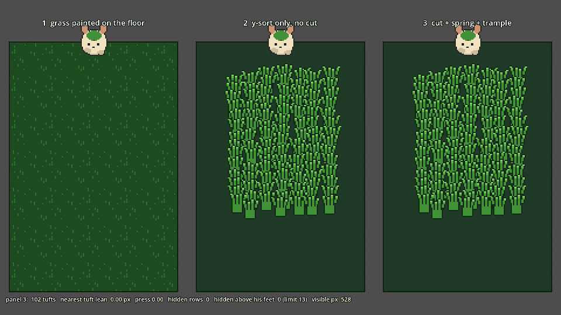
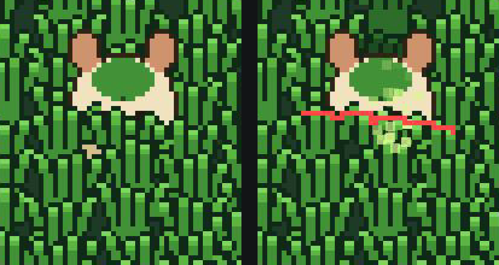

# 2026-11-19 · Interactive tall grass for a top-down pixel game (Godot 4.7)

[中文](README.md) | **English**



Full video: [media/demo.mp4](media/demo.mp4) (16 s, 1920×1080, 60 fps)

## What it is

When the character walks into tall grass, the grass parts, hides the legs, and the tufts that were
stepped on flatten and darken, then grow back. The method comes from SpriteCook's article; I
reproduced it in Godot 4.7.2 with pixel art I generated myself in a script.

Three meadows side by side, one creature walking the same path in each:

1. Grass painted on the floor: nothing happens
2. Tufts as separate y-sorted sprites: the legs are hidden, but bits of the body leak through the gaps
3. The full technique: per-column cut + spring lean + trample and regrow + leaf specks; the red line is the cut computed every frame



## The idea in one sentence

Occlusion is not a static mask: **every frame, for each column of the character's sprite, find
where the grass actually drawn in front of it starts, and hide the character from there down.**
When a tuft leans, the cut line leans with it.

## Original source

- The article (full GDScript, parameters and tick-level acceptance numbers):
  [How to make interactive tall grass for a top-down pixel art game](https://spritecook.ai/blog/interactive-tall-grass-top-down-pixel-art) — SpriteCook, 2026-11-19, tested by the author on Godot 4.6
- The demo video embedded in the article: [@asynkimo](https://x.com/asynkimo/status/2123403348866998503)

`project/tall_grass.gd` and `project/wading.gd` are the article's code as published; their file
headers name the source, and they remain the original author's.

## What I did / changed

| Change | File |
|---|---|
| All pixel art generated in code: 16×18 tufts ×4 plus two darker shades (one ramp step down each), a 4-frame 32×32 creature, a floor tile | `tools/make_art.py` |
| Ported the article's pseudo code to Python and recomputed its acceptance numbers: **all 9 match** (peak lean 6.94 px on tick 11, flattened 18→6 px on tick 8, full height on tick 37, press back to 0 on tick 42) | `tools/ref_model.py`, `tools/ref_model_out.txt` |
| Performance: the reference rebuilds every tuft's image twice per frame (once in `update_sprites`, again during the cut). Added a per-tick cache and a fast path that returns the plain art for idle tufts; behaviour unchanged. 102 tufts × 3 meadows, 0.34 ms CPU per frame | the `LOCAL` lines in `project/tall_grass.gd` |
| The three-meadow comparison scene, leaf specks and the red cut-line overlay (not in the article) | `project/meadow.*`, `main.*`, `specks.gd`, `cut_line.gd` |
| Jittered tuft layout (the article uses a strict grid); both the top and bottom rows are edge tufts, so the patch boundary never shows a dark flattened line | `project/meadow.gd` |

## How to run

```bash
# open project/ in Godot 4.7 and press F5
godot --path project

# regenerate the art (needs Pillow)
python3 tools/make_art.py          # writes to project/assets/

# recompute the acceptance numbers
python3 tools/ref_model.py
```

## Limits

- Top-down only. The per-column cut does not hold for an isometric camera.
- Moving tufts are rebuilt on the CPU every frame: fine for tens to hundreds of tufts; for
  thousands, move the row shift into a shader.
- The cut follows the grass, so the character's texture is re-uploaded every frame; that cost
  comes with the method.
