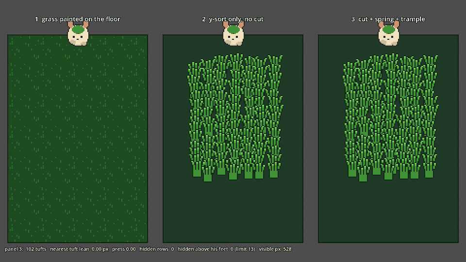
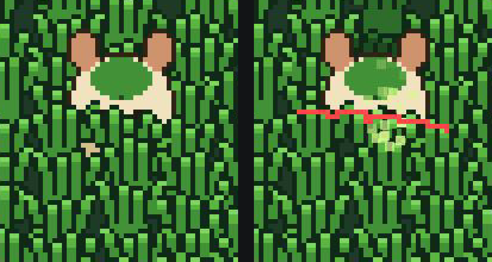

# 2026-11-19 · 俯视像素游戏的高草交互（Godot 4.7）



完整视频：[media/demo.mp4](media/demo.mp4)（16 秒，1920×1080，60 fps）

## 这是什么

角色走进草丛时，草会被推开、挡住腿、踩过的地方压扁变暗再长回来。做法来自 SpriteCook 的博客，
我照着在 Godot 4.7.2 里复现了一遍，美术是自己用脚本画的。

画面是三块地并排，同一只小东西走同一条路：

1. 草直接画在地板上，什么都不发生
2. 草丛是独立精灵、按 y 排序，腿挡住了，但草缝里会漏出几块身体
3. 完整做法：逐列裁切 + 弹簧让开 + 踩踏恢复 + 叶片飞散，红线是每一帧算出来的裁切线



## 核心思路（一句话）

遮挡不是一张静态遮罩，而是**每帧按实际画出来的草，逐列算出角色从哪一行开始隐藏**。草一歪，裁切线就跟着歪。

## 原出处

- 博客原文（含完整 GDScript、参数和逐帧验收数字）：
  [How to make interactive tall grass for a top-down pixel art game](https://spritecook.ai/blog/interactive-tall-grass-top-down-pixel-art) — SpriteCook，2026-11-19，作者标注在 Godot 4.6 上实测
- 博客里的演示视频：[@asynkimo](https://x.com/asynkimo/status/2123403348866998503)

`project/tall_grass.gd` 和 `project/wading.gd` 是博客里贴出来的原文代码，文件头写了出处，
版权归原作者。

## 我做了什么 / 改了什么

| 内容 | 文件 |
|---|---|
| 程序化生成全部像素素材：16×18 草丛 ×4 + 两档暗色（按同一条色阶往下压）、32×32 四帧小生物、地板贴图 | `tools/make_art.py` |
| 把博客的伪代码移植成 Python，重算它给的验收数字：**9 个全部对上**（弹簧峰值第 11 帧 6.94 px，踩扁第 8 帧 18→6 px，第 37 帧长回，第 42 帧 press 归零） | `tools/ref_model.py`、`tools/ref_model_out.txt` |
| 性能：原实现每帧会把每丛草的图重建两遍（`update_sprites` 一遍、裁切时再一遍）。加了每帧缓存和「静止草丛直接用原图」的快路径，行为不变。102 丛 × 3 块地，CPU 每帧 0.34 ms | `project/tall_grass.gd` 里标了 `LOCAL` 的地方 |
| 三联对比场景、叶片飞散、红色裁切线可视化（原文没有） | `project/meadow.*`、`main.*`、`specks.gd`、`cut_line.gd` |
| 草丛排布加了随机抖动（原文是严格网格）；上下两排都标成边缘草丛，不会在草地边上压出一条黑线 | `project/meadow.gd` |

## 怎么跑

```bash
# 用 Godot 4.7 打开 project/，按 F5
godot --path project

# 重新生成素材（需要 Pillow）
python3 tools/make_art.py          # 输出到 project/assets/

# 重算验收数字
python3 tools/ref_model.py
```

## 限制

- 只适合正上方俯视。等距视角下逐列裁切的假设不成立。
- 每帧在 CPU 上重建动起来的草丛图片，几十到几百丛没问题，几千丛需要换成 shader 做行位移。
- 裁切线跟着草变，所以角色贴图也是每帧重传，这是这套方法本身的成本。
